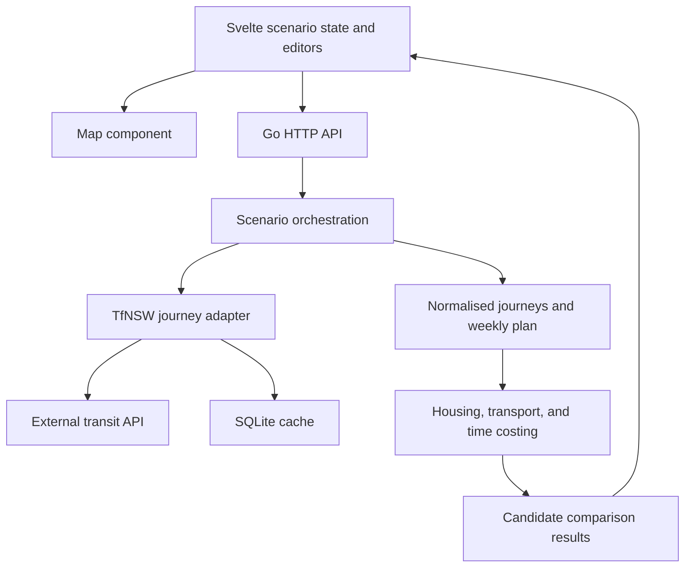

# True Cost of Commute & Location Calculator

## 1. Product Direction

> Is living here worth the extra rent, given how I actually travel?

A **map-first rental comparison tool**, initially for personal use in Sydney. Pin candidate homes, inspect public transport journeys, and compare weekly rent, travel spending, and travel time.

The first customer is the project owner. Learning frontend web development is an explicit goal, alongside building a useful decision tool.

The longer-term vision remains a household housing-and-transport calculator: multiple people and destinations, driving, cycling, park-and-ride, purchase scenarios, and eventually suburb discovery. These are future modules, not MVP requirements.

Related notes:
- [[Property Market - Sydney - 2026-11-23]]
- [[BYD Atto 1 vs Hyundai i30 - Purchase Decision]]

## 2. Agreed Decisions

| Area | Decision | Rationale |
|---|---|---|
| Initial audience | Personal use; project owner first | Validate a real routine before building a general product |
| Housing | Rentals only, with manually entered weekly rent | Avoid purchase modelling and property-data dependencies |
| Travel | Public transport, including walking access/transfer legs | Keep the first useful version narrow |
| Product interaction | Map-first from the first milestone | Location exploration is central, not a later visual enhancement |
| Frontend | Svelte + TypeScript + Vite | Learn reactive UI development through forms, state, maps, and async requests |
| Backend | Go with `net/http` | One small service with clear internal boundaries |
| Map renderer | MapLibre GL JS | No renderer licence fee; tile supplier can change without replacing the renderer |
| Initial map tiles | MapTiler Cloud free personal/non-commercial plan | No annual membership or credit card required for the prototype |
| Address search | Evaluate MapTiler search before committing | Sydney address quality and retention terms still need checking |
| Transit journeys | TfNSW Trip Planner API | NSW-specific public transport planning, independent of map rendering |
| Initial fares | Manually entered weekly estimate per candidate | Do not make a complete Opal billing engine a prerequisite |
| Scenario persistence | Browser storage plus versioned JSON import/export | No accounts or server-side profile database yet |
| Server cache | SQLite when real provider integration needs it | Avoid repeated requests, subject to provider retention rules |
| Production deployment | One Go service serving the built frontend and API | No separate Node production server required |

**MapKit remains a possible future choice, not a planned migration.** Start with free services and reassess based on actual needs, cost, and map quality. MapLibre may remain suitable long term.

## 3. Thin MVP Scope

### Included

- One traveller, initially using adult public transport fares.
- One regular destination, such as work.
- Selected weekdays, target arrival time, and return departure time.
- Several candidate rental addresses or manually placed pins.
- Candidate label, coordinates, weekly rent, and optional listing URL.
- Separate outbound and return journey planning.
- Door-to-door journey details, including walking and transfers.
- Map markers, candidate selection, and selected journey geometry where available.
- Manual weekly transport fare estimate per candidate, clearly labelled.
- Weekly cash outflow, travel hours, subjective time cost, and time-adjusted total.
- Value-of-time slider and comparison against a selected baseline candidate.
- Local save/restore and JSON import/export.

### Explicitly excluded

- Accounts, cloud sync, public sharing links, or property scraping.
- Automatic suburb discovery, suburb medians, boundaries, or heatmaps.
- Driving, tolls, parking, cycling, and park-and-ride optimisation.
- Mortgages, buying-versus-renting analysis, and first-home-buyer incentives.
- Full automatic Opal billing, concession categories, or a claim of exact fares.
- Multi-person editors, shared-car accounting, and chained trips such as work → gym → home.
- Mode-effort weighting and automatic selection of the cheapest weekly itinerary.

One traveller and one destination are initial UI limits. The scenario model should allow collections of people and destinations without implementing their expanded interfaces yet.

## 4. Map-First Experience

### Main layout

- **Map:** primary workspace, initially focused on Sydney.
- **Sidebar:** routine editor and rental candidate list.
- **Selected-candidate panel:** journey details and weekly cost breakdown.
- **Comparison list:** accessible without relying on map colours or marker interactions alone.

### First interaction loop

1. Set the work destination and normal office weekdays/times.
2. Search for a rental address or place a pin.
3. Enter a label, weekly rent, and optional listing URL.
4. Explicitly calculate its public transport journeys.
5. Select a rental to inspect its outbound/return journeys and costs.
6. Compare candidates and adjust the value of time without fetching routes again.

### Interaction rules

- Selecting a sidebar candidate selects its marker, and vice versa.
- Draw only the selected candidate's journey routes to avoid visual clutter.
- Make outbound and return journeys distinguishable, with their travel date/time visible.
- Map panning and zooming do not trigger journey calculations.
- Changed locations or schedule inputs invalidate affected journey results; changed rent or time valuation does not.
- Show loading, unavailable routes, stale results, and provider errors explicitly.
- Missing fares remain unknown, not zero. Cash and time-adjusted totals remain incomplete until the required estimate is supplied.
- An address label can be entered manually for a dropped pin; reverse geocoding is not required for the first prototype.

## 5. Scenario and Journey Model

Use application-owned data with stable IDs. Do not persist SDK markers, provider response objects, or provider place IDs as the sole representation of a location.

### Core concepts

| Concept | Responsibility |
|---|---|
| Scenario | Versioned collection of people, destinations, commitments, candidate homes, and valuation inputs |
| Person | Traveller identity and hourly time valuation; fare category when automated fares are added |
| Location | User-facing label and latitude/longitude; optional source metadata subject to retention terms |
| Travel commitment | Person, destination, weekdays, arrival/departure constraints, and travel preferences |
| Candidate home | Stable ID, location, housing inputs; initially weekly rent and optional listing URL |
| Journey | One door-to-door movement in one direction, with date/time, duration, legs, and provenance |
| Leg | A walking or transit segment with timings, stops/service information, and geometry where available |
| Weekly plan | The selected outbound/return journeys expanded across the representative week's office days |
| Candidate result | Housing and transport cash outflow, travel time by person, time valuation, warnings, and completeness |

### Weekly schedule

Store selected weekdays rather than only a frequency multiplied by two. Outbound and return journeys are separate: route, duration, and service availability can differ.

Use `Australia/Sydney` for local schedule interpretation and resolve recurring commitments against a visible representative calendar week. Provider requests need concrete dates and arrival-versus-departure semantics, including daylight saving. If that week is outside the provider's planning horizon, request a valid week rather than silently substituting one.

For location comparison, prefer scheduled service estimates where supported. Make any real-time adjustment or fallback explicit so a temporary disruption is not silently presented as a typical commute.

A future automated fare module must process chronological journeys per traveller/payment profile, not apply a household-wide cap or independently sum every leg.

## 6. Calculations and Presentation

Keep money, elapsed time, and subjective preference visible as separate quantities. All initial monetary inputs and outputs are in AUD.

For each candidate:

- **Weekly travel hours
** = sum of selected journey durations in the representative week.
- **Weekly transport cash outflow** = manually entered weekly fare estimate for the modelled routine.
- **Weekly cash outflow** = weekly rent + weekly transport cash outflow.
- **Subjective time cost** = weekly travel hours × hourly value of time.
- **Time-adjusted weekly cost** = weekly cash outflow + subjective time cost.

The weekly fare estimate is already a weekly total: do not multiply it by office days or apply caps to it again. Flag it for review when the routine changes. Travel time includes the journey's walking, waiting, transfer, and in-vehicle time without double-counting overlapping duration fields.

For candidate A relative to B, the additional weekly rent justified by commute savings is:

**(B transport spending − A transport spending) + (B time cost − A time cost).**

Show cash-only savings and hours saved alongside this subjective amount. Saving an hour does not create spendable income.

Initially use one unweighted hourly value: no mode-effort multipliers. Changing it must update the comparison without provider requests. Keep financial rules authoritative in Go; any small browser-side calculation used for instant feedback should be checked against shared test fixtures.

## 7. Architecture and Extension Boundaries

Build a **modular monolith**, not microservices or a general plugin framework. Separate external data acquisition from journey costing and comparison.

### Map rendering

- Contain MapLibre calls and SDK objects inside a dedicated map component/integration module.
- Accept ordinary coordinates, candidate/destination markers, selected IDs, and route geometry.
- Emit application events such as location clicked and candidate selected.
- Keep rental data, selected candidates, routines, and journeys in application state outside the map.
- Use ordinary coordinate arrays or GeoJSON at the presentation boundary.
- Do not wrap every SDK operation in a universal map API or implement unused provider adapters.

Changing tile supplier within MapLibre should mostly affect style/configuration and attribution. Switching to MapKit or Google requires replacing the map integration and checking feature parity, credentials, terms, and saved-data reuse; it is not a configuration-only change.

### Address search

Keep search separate from map rendering. Normalise the minimal permitted result fields into the application location model. A neutral format does not grant permission to persist or reuse provider data: verify storage, export, and cross-provider display terms before implementing these behaviours.

### Journey planning

The TfNSW adapter translates requests and responses into application-owned journeys and legs. Provider response schemas must not leak into costing or map code. Preserve source, retrieval time, travel date/time, and warnings. Do not invent a route line when geometry is unavailable.

### Costing and comparison

- Rental housing calculation starts as weekly rent; purchase modelling can be added separately later.
- Transit costing starts with manual weekly estimates; automated fare rules are a separate module.
- Future driving adds a journey adapter and vehicle/toll/parking costing, rather than changing rental comparison logic.
- Time valuation and result aggregation depend on normalised journeys and cost breakdowns, not a particular map or route provider.

Introduce narrow interfaces where there is an actual external dependency or test boundary. Do not build a dynamic module registry upfront.

### Persistence, caching, and credentials

- Save user scenarios locally with an explicit schema version and a migration path.
- Keep cached provider data separate from durable user inputs and manual overrides.
- Cache keys include provider, origin/destination, concrete travel date/time, arrival/departure semantics, and relevant route preferences—not just mode and a broad time bucket.
- Expiry and retained fields follow provider terms. Record provenance and freshness for estimates.
- Keep TfNSW credentials and any signing keys on the backend.
- Browser tile/search keys are visible by design; apply supported origin restrictions and usage limits.
- Send only necessary location/routing inputs to providers. Local scenario storage does not mean external APIs never receive addresses or coordinates.

## 8. Providers, Constraints, and Outstanding Checks

Provider information below was reviewed during planning on 2026-11-25 and must be rechecked before integration or a public launch.

| Capability | Initial choice | Constraints / outstanding checks |
|---|---|---|
| Interactive map | MapLibre GL JS | Renderer only; requires a tile/style supplier and attribution |
| Map tiles | MapTiler Cloud free plan | Personal/non-commercial/prototype use; quotas, logo, and attribution apply; free service pauses at quota exhaustion |
| Address search | MapTiler candidate, not yet committed | Check Sydney address quality, autocomplete, retention/export permissions, and usage accounting |
| Transit routing | TfNSW Trip Planner API | Confirm account/API access, quotas, request fields, geometry, scheduled/real-time controls, and caching/display permissions |
| Transit fares | Manual weekly estimate | Trip Planner's Opal fare component has not been supported since 16 October 2023 |
| Future automatic fares | TfNSW Opal fare tables/business rules | Version rules by effective date; define supported cases and test daily/weekly caps, transfers, and exceptions |
| Possible future map | Apple MapKit JS | Budget for developer membership/access; verify applicable terms before adoption; not a transit-routing replacement |

MapTiler currently lists 5,000 map sessions, 1,000 search sessions, and 100,000 API requests per month on its free plan. These are **not interchangeable allowances**: direct MapLibre tile integration generally uses tile-request accounting, whereas MapTiler SDK integration supports session accounting. Confirm the chosen integration's usage model.

Do not assume public OpenStreetMap tile servers are an unlimited application CDN. Public Nominatim is not the default search backend: it prohibits client-side autocomplete, limits aggregate traffic to one request/second, and imposes identification, attribution, and caching requirements.

### Reference sources

- [MapLibre GL JS](https://maplibre.org/maplibre-gl-js/docs/)
- [MapTiler pricing](https://www.maptiler.com/cloud/pricing/)
- [MapTiler sessions versus requests](https://docs.maptiler.com/guides/account/sessions-vs-requests/)
- [TfNSW Trip Planner API dataset and fare deprecation notice](https://opendata.transport.nsw.gov.au/dataset/trip-planner-apis)
- [TfNSW Opal fares dataset](https://opendata.transport.nsw.gov.au/dataset/opal-fares)
- [Opal benefits and caps](https://transportnsw.info/tickets-fares/fares/opal-benefits)
- [Apple web maps and allowances](https://developer.apple.com/maps/web/)
- [Apple Developer Program enrolment and fees](https://developer.apple.com/help/account/membership/program-enrollment/)
- [Nominatim usage policy](https://operations.osmfoundation.org/policies/nominatim/)

## 9. Incremental Build Plan

### Milestone 1: Map interaction prototype

- [ ] Set up Svelte, TypeScript, and Vite with a MapLibre map focused on Sydney.
- [ ] Confirm MapTiler free-plan eligibility, attribution, key restrictions, and usage accounting.
- [ ] Add a work destination and candidate rental pins with labels, weekly rent, and optional listing URLs.
- [ ] Synchronise selection between map markers and the sidebar.
- [ ] Save/restore locally with a versioned scenario format.
- [ ] Add JSON export/import with input validation.
- [ ] Use clearly labelled sample journeys if needed; do not imply that routing is connected.

**Done when:** the owner can add, select, edit, remove, and restore rental candidates on a map without a routing backend. Address search can follow once its feasibility checks pass; manual pins keep this milestone unblocked.

### Milestone 2: Real public transport journeys

- [ ] Obtain TfNSW access and inspect representative Sydney journey responses before finalising adapter details.
- [ ] Verify provider terms, planning horizon, rate limits, geometry, and permitted caching.
- [ ] Add the Go API and normalised journey/leg model.
- [ ] Add weekdays, arrival/return constraints, and a representative week in `Australia/Sydney`.
- [ ] Fetch distinct outbound/return options and select a default with visible journey details.
- [ ] Draw selected journey geometry where available, including walking legs.
- [ ] Add loading, failure, stale-result, and no-route states.
- [ ] Introduce SQLite caching with appropriate keys and expiry where permitted.
- [ ] Evaluate and integrate address search once quality and retention checks pass.

**Done when:** the owner can inspect real door-to-door outbound/return journeys for a candidate and understand which week and schedule the estimates represent.

### Milestone 3: Useful rental comparison

- [ ] Expand selected journeys into a weekly plan and calculate travel hours.
- [ ] Add labelled manual weekly fare estimates and missing-data handling.
- [ ] Show rent, transport spending, cash total, hours, time valuation, and adjusted total separately.
- [ ] Add a value-of-time slider without route refetching.
- [ ] Compare against a selected baseline and show rent breakeven, cash differences, and hours saved.
- [ ] Test costing and schedule rules, including asymmetric returns and daylight saving.
- [ ] Test frontend interactions and shared calculation fixtures.
- [ ] Validate the complete workflow against the owner's real routine and a few actual rental candidates.

**Done when:** the owner can use the app to compare real rentals, with assumptions and incomplete estimates visible.

## 10. Future Modules and Guardrails

Add these only after the thin workflow is useful:

- **Automatic Opal estimates:** effective-dated fare tables, daily/weekly caps per traveller, transfer rules, off-peak treatment, and explicit unsupported cases. Do not assume geographic leg distance equals Opal charging distance or promise exact fares without validation.
- **More people and destinations:** per-person time valuation and fare profiles; preserve individual travel-time trade-offs rather than only a household score.
- **Driving:** energy/fuel, marginal wear, parking, tolls, and route preferences. Match toll estimates to the actual driving route. Basic OSRM routing does not by itself provide peak-traffic forecasts; evaluate traffic-aware providers and manual overrides.
- **Walking, cycling, e-bike, and park-and-ride:** dedicated routing and mode assumptions; optional effort weights later, with elapsed time always visible.
- **Purchase scenarios:** mortgage cash flow, interest/principal distinction, rates, strata, insurance, maintenance, transaction costs, and holding-period assumptions. Full repayments are cash outflow, not entirely economic cost. Any first-home-buyer incentives need current official eligibility rules rather than frozen thresholds from the original draft.
- **Mortgage-equivalent insight:** show equivalent mortgage principal at a selected rate/term, not lender-assessed borrowing capacity. Separate cash savings from subjective time savings.
- **Suburb discovery:** representative hubs/centroids, housing data with source/date, boundaries, heatmaps, and request-budget controls. A station-centred estimate must not masquerade as an exact property's front-door commute.
- **Sharing and sync:** consider privacy before putting home/work locations in URLs or introducing server-side scenario storage.

The goal is a small useful application with clear extension boundaries—not implementing the long-term product before validating the first rental comparison.
